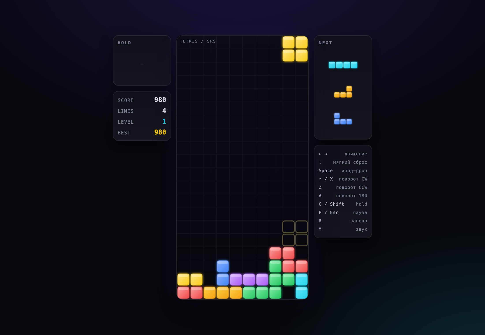

# Тетрис

[](https://github.com/mkirillka/tetris/actions/workflows/tests.yml)

Тетрис в браузере: один экран, без зависимостей, сборки и интернета.
Открывается двойным кликом по `index.html` — и работает, в том числе офлайн.
Интерфейс на русском.

**Играть:** [mkirillka.github.io/tetris](https://mkirillka.github.io/tetris/)



## Что внутри

Механика по гайдлайнам современного тетриса, а не «упрощённая»:

- **Super Rotation System** — правильные таблицы wall-kick отдельно для I и для J/L/S/T/Z, вращение в обе стороны и на 180°.
- **7-bag** — фигуры выпадают честными «мешками» из семи, без залипаний.
- **Hold** — одна фигура в запасе, не чаще одного раза за сброс.
- **Призрак фигуры** — показывает, куда она упадёт.
- **Lock delay** 500 мс с ограничением 15 «перекрутов» на земле.
- **T-spin** определяется и даёт повышенные очки, как и комбо.
- **DAS/ARR** — автоповтор движения с человеческими задержками.
- Скорость по классической кривой `(0.8 − 0.007·L)^(L−1)`, 20 уровней.
- Звук синтезируется через WebAudio: ни одного медиафайла в репозитории.

## Управление

| Клавиши | Действие |
|---|---|
| `←` `→` | движение (с автоповтором) |
| `↓` | мягкий сброс |
| `↑` / `X` | поворот по часовой |
| `Z` | поворот против часовой |
| `A` | поворот на 180° |
| `Space` | хард-дроп |
| `C` / `Shift` | hold |
| `P` / `Esc` | пауза |
| `R` | новая партия |
| `M` | звук вкл/выкл |

На телефоне — экранные кнопки и свайпы по полю: сдвиг по горизонтали,
тап — поворот, свайп вниз — хард-дроп, вверх — hold.

## Запуск

**Просто открыть файл:**

```sh
open index.html
```

**Локальный сервер** (нужен только для тестов и если хочется открыть с телефона):

```sh
python3 -m http.server 8000
# http://localhost:8000
```

**Выложить куда угодно** — это статика из нескольких файлов: GitHub Pages, Netlify, любой nginx.

## Приложение в Dock (macOS)

Скрипты ниже работают **только на macOS**: `install-dock.sh` использует `plutil`, `osascript`,
`defaults` и `killall Dock`, `build-icons.sh` — `sips` и `iconutil`. Сама игра от платформы
не зависит: на Linux и Windows достаточно открыть `index.html`.

`tools/install-dock.sh` собирает `~/Applications/Тетрис.app` со своей иконкой
и кладёт его в Dock. Приложение открывает игру отдельным окном Chrome,
без адресной строки и вкладок.

```sh
./tools/install-dock.sh              # собрать и добавить в Dock
./tools/install-dock.sh --no-dock    # только собрать приложение
```

Права администратора не нужны. Приложение запоминает путь к игре: если папку
переместить, запусти скрипт заново.

Удалить: перетащить «Тетрис» из Dock в корзину и удалить `~/Applications/Тетрис.app`.

Иконка собирается из `assets/icon.svg` скриптом `tools/build-icons.sh`
(нужны только `sips`, `iconutil` и Chrome для растрирования SVG).

## Тесты

Автотесты работают с настоящей разметкой из `index.html`: подменяют время
и кадры, нажимают реальные клавиши и проверяют состояние игры. В конце партию
играет бот, который оценивает позиции.

Из командной строки (нужен Chrome, зависимостей нет):

```sh
./tools/run-tests.sh
```

Скрипт поднимает статический сервер, прогоняет `tools/test.html` в headless Chrome
и возвращает ненулевой код, если хоть одна проверка упала. То же самое делает CI
на каждый push и pull request.

Вручную, с отчётом на экране:

```sh
python3 -m http.server 8000
open http://localhost:8000/tools/test.html
```

35 проверок: движение, повороты, hold, пауза, очистка линий, уровни, счёт,
Game Over, рекорд, раскладка под окно, снятие обработчиков.

## Структура

```
index.html               разметка, подключает стили и игру
assets/styles.css        оформление, включая мобильную раскладку
assets/game.js           вся логика и отрисовка
assets/icon.svg          иконка (вектор)
assets/*.png             иконки для браузера и Dock
tools/test.html          автотесты
tools/run-tests.sh       прогон автотестов в headless Chrome (для CI и терминала)
tools/build-icons.sh     сборка иконок из SVG
tools/install-dock.sh    приложение для Dock
```

## Встраивание

`assets/game.js` не трогает глобальный объект игры и отдаёт одно имя —
`Tetris.createTetris(root, options)`. Он возвращает интерфейс:

| Метод | Назначение |
|---|---|
| `start()` | начать новую партию |
| `togglePause()` | пауза / продолжение |
| `getState()` | снимок состояния: фаза, поле, фигура, очередь, счёт |
| `destroy()` | снять обработчики и остановить цикл |

Необязательные параметры — `clock`, `scheduleFrame`, `random` — подменяют
источник времени, планировщик кадров и генератор случайных чисел. Это нужно
для тестов и встраивания; по умолчанию используются браузерные.

```html
<div id="game">…разметка из index.html…</div>
<script src="assets/game.js"></script>
<script>
  const game = Tetris.createTetris(document.getElementById('game'));
</script>
```

## Лицензия

[MIT](LICENSE)
